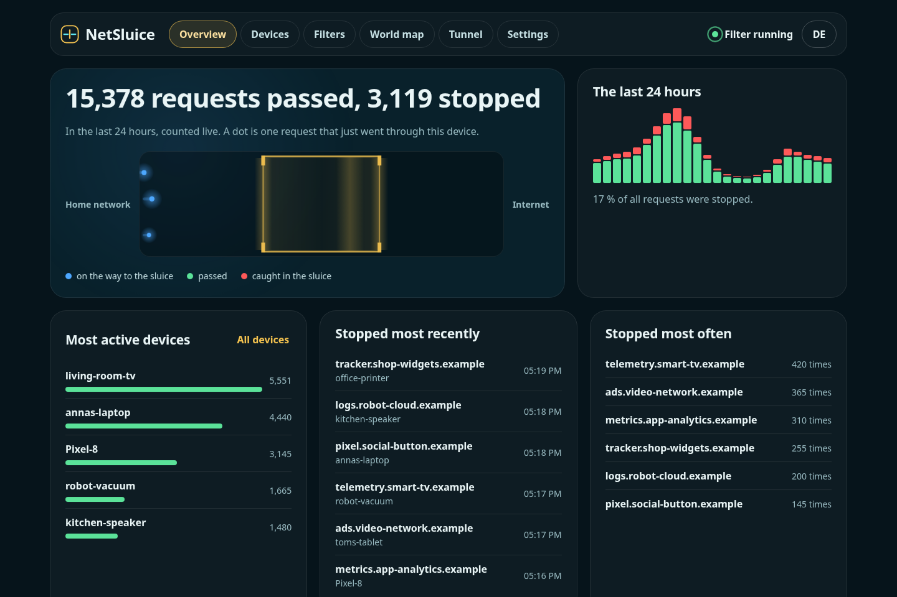
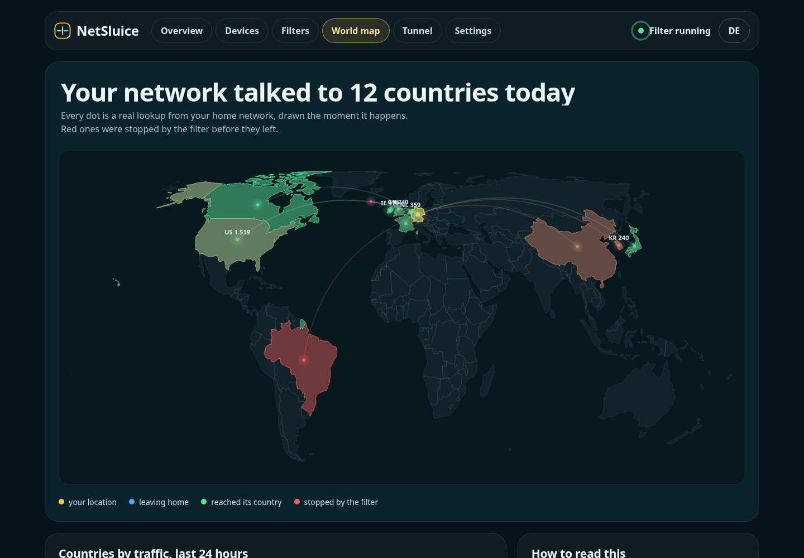
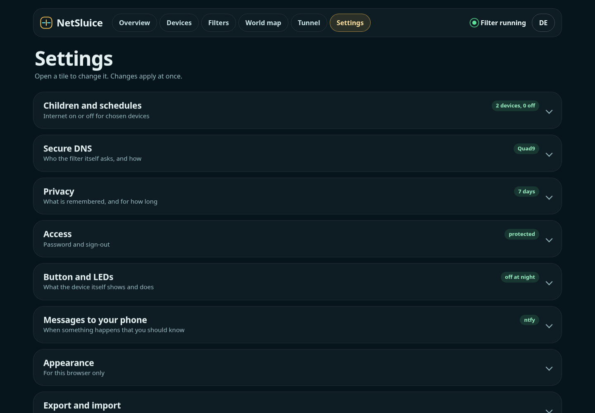

<p align="center"></p>

# NetSluice

A second life for the Deeper Connect Mini: plain Debian instead of the vendor's
AtomOS, and on top of it a network filter with its own web interface.

A sluice is a gate that lets water through or holds it back. NetSluice does
that for the traffic of a home network: it answers the DNS lookups of every
device, stops the ones on your block lists, and shows you what happened.

> This project is not affiliated with, endorsed by, or supported by Deeper
> Network. "Deeper Connect" is their trademark and is used here only to say
> which hardware this runs on.



| | |
|---|---|
|  |  |
|  |  |

The pictures show the demo with made-up data. You can run it yourself, without
a device: `python3 scripts/demo.py`, then open <http://127.0.0.1:8099/>.

## What it does

- **Filter** for the whole network, with the block lists known from AdGuard
  Home and Pi-hole. One switch per list.
- **Overview** with a live view: lookups arrive, are checked, and pass or burst.
- **Devices**, sorted by activity, with name, maker, kind and, where a device
  announces it, model and firmware.
- **World map** of where the network talks to, coloured by traffic and by how
  much was stopped.
- **Children and schedules**: internet on or off per device, by hand or by
  time of day, with extra time at the press of a button.
- **Settings** for encrypted DNS (DoH, DNSSEC), privacy, the board's LEDs and
  button, messages to a phone (ntfy or webhook), appearance, export and import,
  name and system updates.
- English and German.

## Status: early, tested on one device

Everything here was developed and tested on a single Deeper Connect Mini with
the board marking `mini_v21_20210521`. It runs that owner's home network.

| | |
|---|---|
| Works | boot from microSD, installation to the internal eMMC, both Ethernet ports at 1 Gbit/s, LEDs, button, everything listed above |
| Not built yet | a ready-made image that works without any setup, HTTPS, the WireGuard tunnel, backup and restore of the original system from the interface, self-update, inline ("sluice") and listening mode, changing the fixed address from the interface |
| Not working | USB-C as a data port (it still powers the device) |
| Untested | other board revisions; the other Deeper models (Pico, Nano, Air) are different hardware |

If you try this on another board, please report what you find, including failures.

## How it gets onto the device

The Mini is a close relative of the FriendlyELEC NanoPi R2S (Rockchip RK3328),
and AtomOS itself is built on Armbian. The vendor bootloader looks for a boot
script on the microSD card **before** it starts the internal system. So a
suitable card is all it takes: no soldering, no opening the case, and the
original system comes back when you remove the card.

A stock NanoPi R2S image does not boot, though. Three things differ on this
board; `dts/patch_dts.py` corrects them. See [docs/hardware.md](docs/hardware.md).

### Before you start

- **Your wallet.** If your device holds a wallet, make sure you have its seed
  phrase or keystore first.
- **Check your board (optional, recommended).** `scripts/probe` builds a tiny
  boot script that makes the bootloader write its settings to the card. It
  changes nothing on the device. See [docs/hardware.md](docs/hardware.md#probing-a-board).

### 1. Boot Armbian from a card

You need a Linux computer, a microSD card (16 GB or more) and `python3`, `dtc`,
`e2fsprogs`, `util-linux`, `xz`.

```bash
# the Armbian image for the NanoPi R2S (Debian, minimal) from https://www.armbian.com/nanopi-r2s/
scripts/build-image.sh Armbian_*_Nanopi-r2s_*_minimal.img.xz
sudo dd if=deeper-connect-mini-armbian.img of=/dev/sdX bs=4M conv=fsync status=progress
```

Double-check the device name, `dd` erases it. Unplug the Mini, insert the
card, connect one Ethernet port and power it up. The first boot takes two to
three minutes. Log in over SSH as `root`; Armbian asks for a new password on
the first login. Its default password is public, so do this right away.

### 2. Install NetSluice on it

```bash
scripts/deploy-dev.sh root@<device>                          # the interface and the service
ssh root@<device> 'sh -s' < provision/install-stack.sh       # everything they need
```

Open `http://<device>/`. The first visitor chooses the password. Then either
enter the device's address as the DNS server in your router, or give the
device the address your old filter had.

### 3. Optional: move to the internal storage

The card is slow (about 24 MB/s). The eMMC is five times faster.
`provision/install-to-emmc.sh` copies the running system there. **It erases
the original system.** Back it up first, for example with
`dd if=/dev/mmcblk0 of=/root/atomos.img bs=4M`, and copy the backup off the
device. The vendor bootloader is never touched: the script compares that area
before and after and refuses to finish if it changed.

To go back: boot from the card and write the backup to `/dev/mmcblk0`.

## For developers

[docs/development.md](docs/development.md) explains how the parts fit together,
how to change them and how to test.

## Privacy

NetSluice sees which device on your network asks for which host. That stays
on the device unless you turn on messages to your phone, which leave through
the service you choose. At home this is your call. If other people use the
network, tell them.

## Licence and warranty

MIT for the code and documentation, see [LICENSE](LICENSE). What NetSluice
builds on is listed in [THIRD-PARTY.md](THIRD-PARTY.md).

There is no warranty. You are modifying a network device at your own risk, and
a filter that fails takes the name lookups of your network with it.
