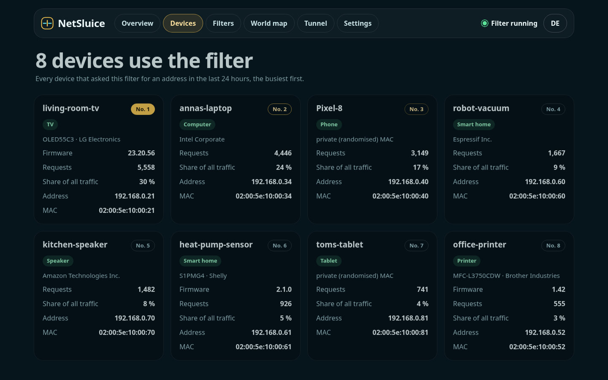
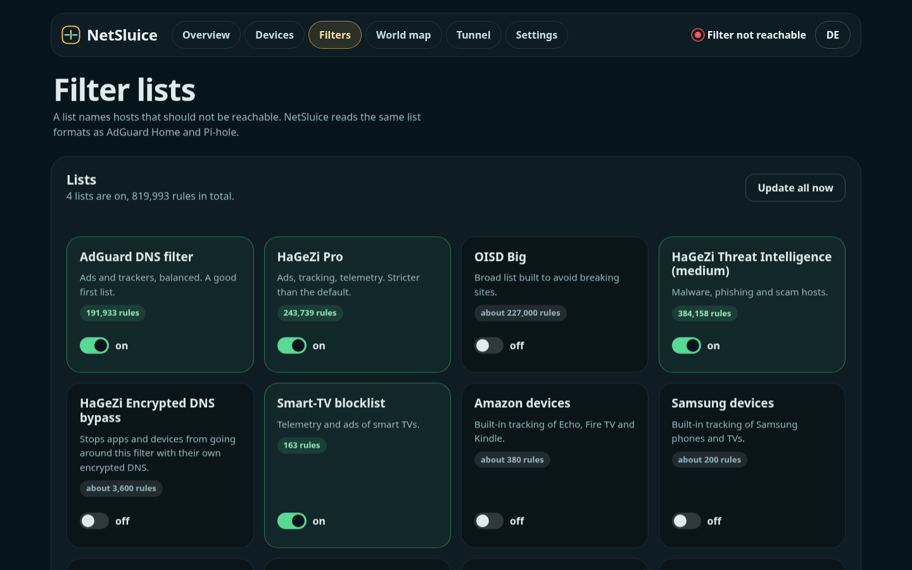

<p align="center"></p>

# NetSluice

A second life for the Deeper Connect Mini: plain Debian instead of the vendor's
AtomOS, and on top of it a network filter with its own web interface.

A sluice is a gate that lets water through or holds it back. NetSluice does
that for the traffic of a home network: it answers the DNS lookups of every
device, stops the ones on your block lists, and shows you what happened.

**Website: <https://netsluice.loopout.tech>** (English and German), with the
documentation, the downloads with their checksums, and a live demo of the
interface that runs in your browser with made-up data.

> This project is not affiliated with, endorsed by, or supported by Deeper
> Network. "Deeper Connect" is their trademark and is used here only to say
> which hardware this runs on.


| | |
|---|---|
|  |  |
|  |  |

The pictures show the demo with made-up data. You can run it yourself, without
a device: `python3 scripts/demo.py`, then open <http://127.0.0.1:8099/>.

## What it does

- **Filter** for the whole network, with the block lists known from AdGuard
  Home and Pi-hole. One switch per list.
- **Overview** with a live view: lookups arrive, are checked, and pass or burst.
- **Devices**, the one that is stopped most often first, with name, maker,
  kind and, where a device announces it, model and firmware. A click on a device
  opens its page: requests per hour, the names stopped and let through most
  often, and its newest requests one by one.
- **World map** of where the network talks to, coloured by traffic and by how
  much was stopped.
- **Children and schedules**: internet on or off per device, by hand or by
  time of day, with extra time at the press of a button.
- **Settings** for encrypted DNS (DoH, DNSSEC), privacy, the board's LEDs and
  button, messages to a phone (ntfy or webhook), appearance (three designs,
  each in dark and light), export and import,
  name and system updates.
- **Updates of NetSluice itself** from the releases here on GitHub, by hand or
  once a day. If the new version does not start, the old one is put back.
- **Back up and install**: keep a copy of the original system, move NetSluice
  to the internal storage, and put the copy back if you change your mind.
- **HTTPS** in your own network, if you switch it on: the device signs its own
  certificate and offers the root certificate to import, so browsers stop
  warning. Plain HTTP keeps working.
- English and German.

## Status: early, tested on one device

Everything here was developed and tested on a single Deeper Connect Mini with
the board marking `mini_v21_20210521`. It runs that owner's home network.

| | |
|---|---|
| Works | a ready-made image for the microSD card, boot from microSD, backup of the internal storage, installation to it and putting the backup back, all from the interface, both Ethernet ports at 1 Gbit/s, LEDs, button, everything listed above |
| Not built yet | inline ("sluice") and listening mode, changing the fixed address from the interface |
| Not working | USB-C as a data port (it still powers the device) |
| Untested | other board revisions. The other Deeper models (Pico, Nano, Air) are different hardware |

If you try this on another board, please report what you find, including failures.

### An idea for later: the tunnel

Not planned yet, but it would fit: a WireGuard tunnel, so that a phone or a
laptop uses this filter from anywhere, not only at home. The device already
brings WireGuard along. A page would add a device and show a QR code for the
WireGuard app. Only the name lookups would travel through the tunnel. What
NetSluice cannot do by itself is make the device reachable from outside: that
needs a forwarded port on the router and an address that can be found. If you
would use this, say so in the [issues](https://github.com/Anarki-LNX/netsluice/issues).

## How it gets onto the device

The Mini is a close relative of the FriendlyELEC NanoPi R2S (Rockchip RK3328),
and AtomOS itself is built on Armbian. The vendor bootloader looks for a boot
script on the microSD card **before** it starts the internal system. So a
suitable card is all it takes: no soldering, no opening the case, and the
original system comes back when you remove the card.

A stock NanoPi R2S image does not boot, though. Three things differ on this
board. `dts/patch_dts.py` corrects them. See [docs/hardware.md](docs/hardware.md).

There are two ways: the ready-made image, or building it yourself.

## The easy way: the ready-made image

You need a microSD card (8 GB or more), a network cable to your router, and
any computer to write the card.

1. **Download** the newest `netsluice-<version>-deeper-connect-mini.img.xz` from
   the [releases](https://github.com/Anarki-LNX/netsluice/releases). Not every
   release brings an image: small ones reach a running device as an update,
   under Settings, Updates.
2. **Write it to the card** with [balenaEtcher](https://etcher.balena.io/) or
   the Raspberry Pi Imager ("Use custom"). Both take the `.xz` file as it is.
3. **Unplug the Mini, insert the card, connect it to your router, power it up.**
   The green LED blinks while NetSluice sets itself up. This takes a few
   minutes and needs no internet: the image brings everything along. When the
   green LED is steady, it is ready. A steady red LED means a step failed. It
   is tried again every minute. While it works, the device shows a page with
   the current step, and what is wrong if one fails, at the same address as
   the interface later.

Then open **http://netsluice.local/** (or the address your router shows for
the device "netsluice"). The first visitor chooses the password, so do this
right away. Finally enter the device's address as the DNS server in your
router, and every device at home is filtered. The filter lists are downloaded
as soon as the device reaches the internet. Until then nothing is stopped.

Good to know:

- **Nothing on the device is changed.** NetSluice runs from the card. Remove
  the card and the original system starts again, wallet included. When you
  are sure, Settings → "Back up and install" keeps a copy of the original
  system and moves NetSluice to the internal storage.
- **There is no login to the system underneath.** SSH is off and the system
  account is locked. If you want SSH, put your public key on the card as
  `/boot/netsluice-ssh.pub` before a start (the card is ext4, so this needs a
  Linux computer). SSH then accepts that key and no passwords.
- **Updates** arrive through the interface, under Settings → Updates.
- To check the download: `sha256sum -c netsluice-*.img.xz.sha256`.

## The other way: build it yourself

Before you start:

- **Your wallet.** If your device holds a wallet, make sure you have its seed
  phrase or keystore first.
- **Check your board (optional, recommended).** `scripts/probe` builds a tiny
  boot script that makes the bootloader write its settings to the card. It
  changes nothing on the device. See [docs/hardware.md](docs/hardware.md#probing-a-board).

### 1. Boot Armbian from a card

You need a Linux computer, a microSD card (16 GB or more) and `python3`, `dtc`,
`e2fsprogs`, `util-linux`, `xz`.

```bash
# the Armbian image for the NanoPi R2S (Debian, minimal) from https://www.armbian.com/nanopi-r2s/
scripts/build-image.sh Armbian_*_Nanopi-r2s_*_minimal.img.xz
sudo dd if=deeper-connect-mini-armbian.img of=/dev/sdX bs=4M conv=fsync status=progress
```

Double-check the device name, `dd` erases it. Unplug the Mini, insert the
card, connect one Ethernet port and power it up. The first boot takes two to
three minutes. Log in over SSH as `root`. Armbian asks for a new password on
the first login. Its default password is public, so do this right away.

### 2. Install NetSluice on it

```bash
scripts/deploy-dev.sh root@<device>                          # the interface and the service
ssh root@<device> 'sh -s' < provision/install-stack.sh       # everything they need
```

Open `http://<device>/`. The first visitor chooses the password. Then either
enter the device's address as the DNS server in your router, or give the
device the address your old filter had.

### 3. Optional: move to the internal storage

The card is slow (about 24 MB/s). The eMMC is five times faster. Under
Settings, "Back up and install" does it in three steps: it writes a complete
copy of the internal storage to the card (download it to your computer as
well), copies NetSluice to the internal storage, and can write the backup back
later. **Installing erases the original system**, so make the backup first.
The vendor bootloader is never written: the installation compares that area
before and after and refuses to finish if it changed.

By hand, on a device that runs from the card:
`CONFIRM=erase-emmc bash /usr/share/netsluice/service/netsluice-install.sh`

## For developers

[docs/development.md](docs/development.md) explains how the parts fit together,
how to change them and how to test.

## Privacy

NetSluice sees which device on your network asks for which host. That stays
on the device unless you turn on messages to your phone, which leave through
the service you choose. At home this is your call. If other people use the
network, tell them.

About once a day the device asks GitHub whether there is a new version. GitHub
sees your address for that and nothing else.

## Licence and warranty

MIT for the code and documentation, see [LICENSE](LICENSE). What NetSluice
builds on is listed in [THIRD-PARTY.md](THIRD-PARTY.md).

There is no warranty. You are modifying a network device at your own risk, and
a filter that fails takes the name lookups of your network with it.
